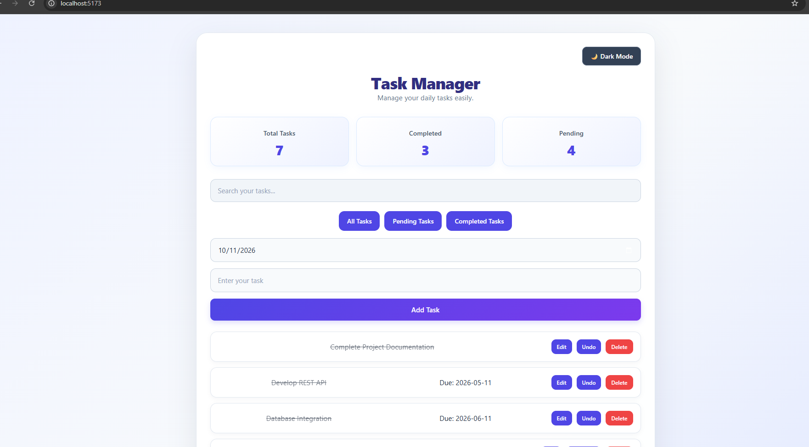
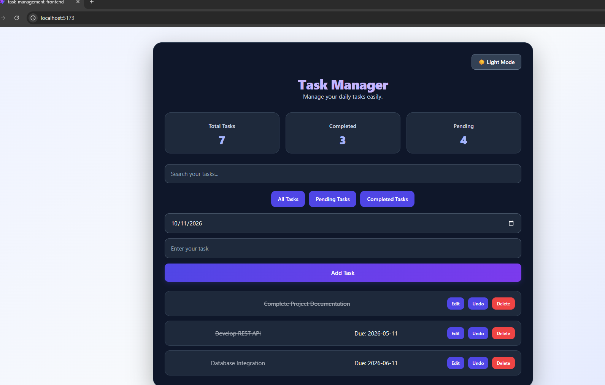

Task Manager – Full Stack Web Application

A simple and user-friendly Task Manager application built to manage daily tasks efficiently.

This application allows users to create, update, delete, search, and track tasks. It provides a clean interface with task status filters and Dark/Light Mode.

Features:

. Add new tasks with title, description, and due date.
. Edit existing tasks.
. Delete tasks.
. Mark tasks as completed or pending.
. Search tasks by title.
. Filter tasks by All, Pending, and Completed.
. Dark Mode and Light Mode.
. Store tasks in a MySQL database.

Technologies Used:

Frontend:

. React.js
. JavaScript
. CSS

Backend:

. Java
. Spring Boot
. Spring Data JPA
. Hibernate
. REST APIs

Database:

. MySQL

Installation and Setup:

Follow these steps to run the project locally.

1. Clone the Repository

git clone https://github.com/priyamarya-hub/task-manager.git
cd task-manager

2. Backend Setup

. Open the task-management folder.
. Configure your MySQL database in application.properties.
. Run the Spring Boot application:

.\mvnw.cmd spring-boot:run

Backend URL: http://localhost:8080

3. Frontend Setup

. Open a new terminal.
. Navigate to the frontend folder:

cd task-management-frontend

. Install dependencies:

npm install

. Start the React application:

npm run dev

Frontend URL: http://localhost:5173

Screenshots

1. Task Manager - Light Mode

2. Task Manager - Dark Mode

